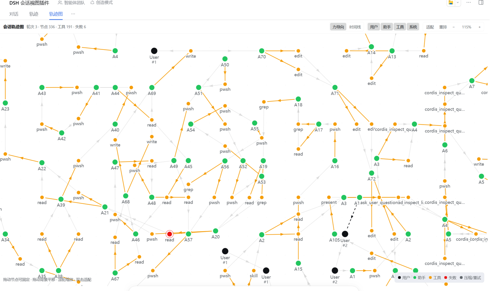
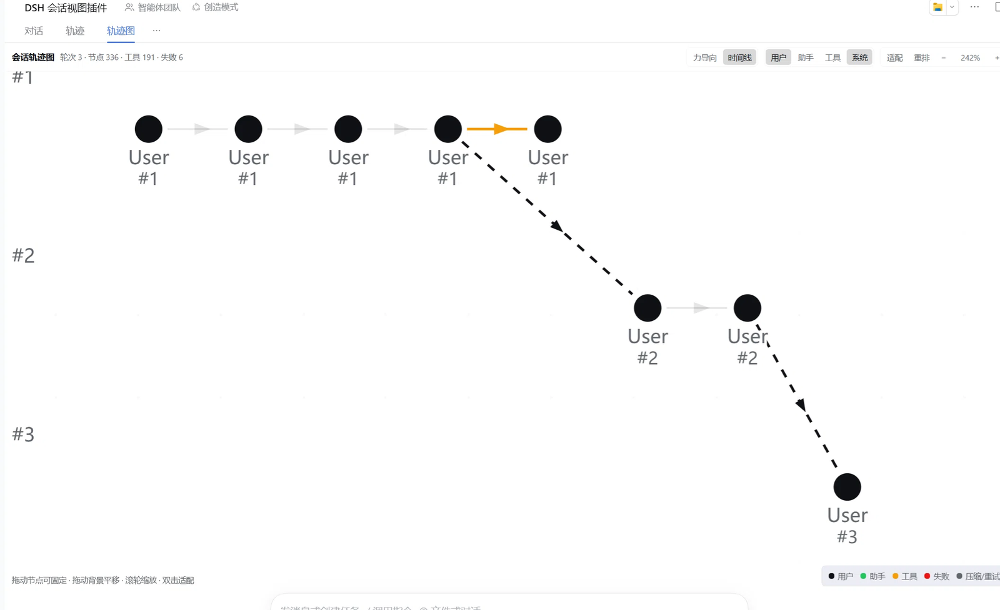

# Session graph · 会话轨迹图

A DSH Web UI plugin that adds a **Graph** view to the Conversation view tabs.
It renders the session trajectory as an interactive **directed force graph**:
turns, user messages, assistant steps, tool calls, retries, and compactions
become nodes; causal edges connect assistant steps to the tool calls they
issue, tool results back into the next assistant step, and completed turns to
the next turn.

把会话轨迹画成可交互的有向力导向图：轮次、用户消息、助手步骤、工具调用、
上下文压缩与模型重试都是节点；边表示「助手步骤 → 工具调用」「工具结果 →
下一步助手」「上一轮 → 下一轮」等因果关系。支持力导向／时间线两种布局、
节点类型筛选、缩放平移、详情面板与工具检查器跳转。

**Author / 作者**：Jinzhu.Zhang <freeheart1977@139.com>
**License / 许可证**：MIT（见 [LICENSE](LICENSE)）

Everything is derived from the loaded Session event window (`SessionBinding`
event source), so it stays correct across fork, resume, and replay without any
Host state.

## Screenshots · 效果预览

### Force layout · 力导向布局



A real session rendered as a directed force graph (336 nodes, 191 tool calls,
6 failures). Assistant steps are the green circles, tool calls are amber (failed
ones red), large dark circles are user messages labelled with their turn number,
and dashed edges mark turn boundaries.

### Timeline layout · 时间线布局



The same session in timeline mode: one horizontal lane per turn (`#1`, `#2`,
`#3`) with chronological order left to right. This capture filters to user
nodes to make the turn structure obvious; toolbar, filters, pan and zoom behave
identically in both layouts.

## What it shows

Node colors come from host theme tokens, so they follow the active light/dark
theme (the screenshots use the author's light theme, where `brand-primary`
renders near-black). Semantic meaning is stable across themes:

| Node | Theme token | Meaning |
| --- | --- | --- |
| User message | `brand-primary` | A user message |
| Assistant step | `state-success-primary` | An assistant message (one step) |
| Tool call | `state-warn-primary` | A tool call, merged with its result |
| Failed tool / retry | `state-error-primary` | A failed tool result, or a model retry |
| Compaction | `label-secondary` | A context compaction |

Edges: `assistant → tool` (call), `tool → assistant` (the result feeds the next
step), `turn → turn` (dashed boundary), compaction/retry links.

## Using it

1. Open any session; the conversation view tab row shows `Chat · Trajectory · Graph`.
2. Select **Graph**.
3. Toolbar: switch **Force** / **Timeline** layout, filter node kinds, add an
   earlier history page (`Load older` when the window is truncated), `Fit`,
   or re-run the simulation.
4. Canvas: drag a node to pin it, drag the background to pan, wheel to zoom,
   double-click the background to fit. Hovering shows details on canvas;
   clicking opens the side panel (tool calls can open the tool inspector when
   the host offers one).

## Install (for other people)

This directory is both the plugin bundle and the skill bundle: the same folder
can be installed into a DSH profile as a plugin, and copied into a skills root
so an agent can perform the installation and explain the view.

### 1. Install the plugin bundle

Requires a DSH profile with the `plugin_manager` tool (GUI: Settings → Plugins):

```
plugin_manager({ action: "install_bundle", target: "<absolute path to this directory>" })
```

Expect `application: "applied"` and `warnings: []`. Then refresh the Web UI (or
open a new session) and switch the conversation tab row to **Graph**.

Without the tool, do the equivalent by hand: add this package to the profile
`package.json` dependencies (local `link:` path), append its name to
`dsh.profile.bundles`, and let pnpm link it. See `INSTALL.md`, shipped next to
the published archive, for the exact steps.

### 2. Install the skill (optional, lets an agent do it)

Copy or symlink this directory to one scanned skill root, keeping the directory
name `dsh-session-graph`:

| Scope | Path |
| --- | --- |
| User (DSH) | `%USERPROFILE%\.dsh\skills\dsh-session-graph` (Unix: `~/.dsh/skills/...`) |
| Project | `<repo>/.agents/skills/dsh-session-graph` |

The `dsh-skill-filesystem` provider must be enabled in the profile; the skill
appears in the session catalog as `dsh-session-graph` and instructs an agent to
call `plugin_manager.install_bundle` on the directory, verify the live
`conversation.view` slot, and walk the user through the Graph tab.

### 3. From a git checkout / archive

```sh
git clone <repository-url> dsh-session-graph
# then either install the bundle from that directory, or copy it into a skills root
```

## Package shape

- `SKILL.md` — skill frontmatter + installation/usage runbook for an agent.
- `index.js` — Host half, intentionally empty: the Client module does the work.
- `client.js` — the wire Client module (`window.__ModuleLoader__` factory). It
  registers one `conversation.view` entry (`id: "graph"`) via `ctx.slots` and
  reads the session event window from its registration `inject` props.
- `locale/en.json`, `locale/zh.json` — Plugin Manager display metadata.
- `icon.svg` — original artwork.
- `docs/screenshots/` — the effect screenshots embedded above.
- `test/smoke.mjs` — headless checks (no browser required).

The Client module uses only the `react` runtime module and host theme tokens
(`--dsw-alias-*`); it imports no Harness Client package.

`client.js` exposes `__internals` (`buildModel`, `contractModel`,
`timelinePositions`, `summarizeArgs`, `textFromContent`, `prepareSim`,
`stepSimulation`, `fitView`) so the pure graph model can be exercised without a
browser.

## Development

```
node test/smoke.mjs                 # synthetic session, no fixture needed
node test/smoke.mjs ../client.js fixture.json   # fold a real session event list
```

The smoke test loads `client.js` through a fake `window.__ModuleLoader__`, then
exercises the model fold, edge contraction, layouts, simulation, and the slot
registration path. It is excluded from the published package `files`, so use a
git checkout to run it.

## Verification status

- `node --check` passes for both halves; the manifest, locale JSON, patch, and
  `icon.svg` (valid SVG) are valid.
- The bundle installed with `application: applied` and no warnings; the profile
  links this directory and lists `@local/session-graph` in its bundles.
- Live Client slot inspection reports the `graph` entry registered, active, and
  ordered after `chat` and `trajectory`; HMR reloads of this linked bundle keep
  exactly one registration.
- The headless smoke suite passes (~60 checks).
- Rendered visual verification: the screenshots above were captured from a live
  DSH profile and confirm that both layouts render (force: 336 nodes / 191 tool
  calls / 6 failures; timeline: turn lanes). Automated pixel comparison and
  light/dark theme switching are not part of the smoke suite.

## Author & license

Copyright (c) 2026 Jinzhu.Zhang <freeheart1977@139.com>. Released under the
[MIT License](LICENSE); the license notice must be retained in copies and
substantial portions of the software, including redistributed plugin bundles.
